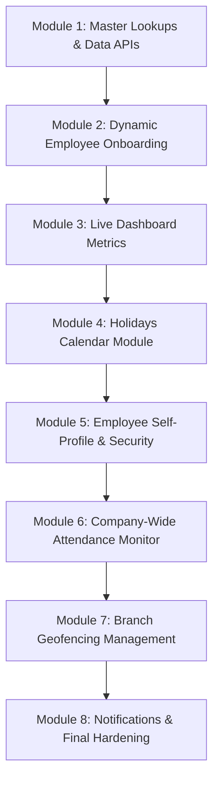

# AlienHR — Full Task-by-Task Production Backlog

---

## MODULE 1: Master Lookups & Organization Data
> **Goal:** Expose relational master entities so the mobile app doesn't hardcode IDs or options.

### Task 1.1: Backend Master Lookup Controller
* **Target Files**:
  * `HRMS.API/Controllers/LookupController.cs`
  * `HRMS.API/DTOs/Lookup/LookupDto.cs`
* **Implementation Details**:
  * Create `GET /api/Lookup/departments` (returns `id`, `name`, `code` for all active departments).
  * Create `GET /api/Lookup/designations` (returns `id`, `name` for designations).
  * Create `GET /api/Lookup/employment-types` (returns `id`, `name`).
  * Create `GET /api/Lookup/roles` (returns `roleId`, `roleName`).
  * Create `GET /api/Lookup/branches` (returns `branchId`, `branchName`, `city`).
* **Definition of Done**: All 5 endpoints return active records with HTTP `200 OK`.

### Task 1.2: Flutter Lookup Service & Generic Model
* **Target Files**:
  * `lib/models/lookup_item.dart`
  * `lib/services/lookup_service.dart`
  * `lib/core/constants/api_constants.dart`
* **Implementation Details**:
  * Define `LookupItem` class with `id`, `name`, `code`.
  * Add endpoint constants in `ApiConstants`.
  * Implement `getDepartments()`, `getDesignations()`, `getEmploymentTypes()`, `getBranches()`, and `getRoles()`.
* **Definition of Done**: Service methods fetch and parse JSON lists without type casting errors.

---

## MODULE 2: Dynamic Employee Onboarding & Management
> **Goal:** Enable admins to create and edit employees with live dropdowns, proper validation, and zero hardcoded IDs.

### Task 2.1: Replace Hardcoded Values in Employee Form
* **Target Files**:
  * `lib/ui/employee/employee_form_page.dart`
* **Implementation Details**:
  * Load all master lookup lists concurrently in `initState()`.
  * Replace the empty `items: const []` in Department with the dynamic API list.
  * Replace static text `"Bandarawela"` with a dynamic Branch dropdown.
  * Replace static text `"Sales Assistant"` with a dynamic Designation dropdown.
  * Replace static text `"Employee"` with a dynamic Role dropdown.
  * Replace hardcoded employment types with the API list.
  * Submit selected IDs in `CreateEmployeeRequest` instead of fixed `1`s and `4`s.
* **Definition of Done**: Form displays live dropdowns and submits real selected IDs in the payload.

### Task 2.2: Employee Edit Mode Pre-population
* **Target Files**:
  * `lib/ui/employee/employee_form_page.dart`
  * `lib/services/employee_service.dart`
* **Implementation Details**:
  * When opening an existing employee, pre-populate all dropdown selections (`branchId`, `departmentId`, `designationId`, `employmentTypeId`).
  * Support updating existing records via `PUT /api/Employee/{id}`.
* **Definition of Done**: Saving an edited employee updates the database without resetting unchanged relations.

---

## MODULE 3: Live Dashboard Metrics (Eliminate All Mock Data)
> **Goal:** Replace 100% hardcoded statistics on Admin and Manager Dashboards with live queries.

### Task 3.1: Backend Dashboard Endpoints
* **Target Files**:
  * `HRMS.API/Controllers/DashboardController.cs`
  * `HRMS.API/DTOs/Dashboard/AdminSummaryDto.cs`
  * `HRMS.API/DTOs/Dashboard/ManagerSummaryDto.cs`
  * `HRMS.API/Service/Dashboard/DashboardService.cs`
* **Implementation Details**:
  * `GET /api/Dashboard/admin-summary`:
    * `totalEmployees`: Total non-deleted employees count.
    * `presentToday`: Employees with check-in today count.
    * `onLeaveToday`: Employees with approved leave today count.
    * `absentToday`: `totalEmployees - (presentToday + onLeaveToday)`.
    * `pendingLeaves`: Total pending leave requests count.
    * `lateEmployees`: Check-ins after 08:00 AM count.
    * `missingCheckOut`: Checked in without check-out after 17:00 count.
  * `GET /api/Dashboard/manager-summary?branchId={id}`:
    * Same metrics scoped to manager's branch.
    * List of employees on leave today (`name`, `leaveType`, `duration`).
    * Weekly attendance breakdown (% present Mon–Fri).
* **Definition of Done**: Endpoints return accurate counts calculated directly from database tables.

### Task 3.2: Connect Admin Dashboard to Live API
* **Target Files**:
  * `lib/ui/home/admin/admin_dashboard.dart`
  * `lib/services/dashboard_service.dart`
  * `lib/models/admin_summary.dart`
* **Implementation Details**:
  * Remove `totalEmployees = 245`, `present = 218`, `onLeave = 12`, `absent = 15`.
  * Add pull-to-refresh to fetch live `/api/Dashboard/admin-summary`.
  * Update "Today's Attendance Overview" progress bar dynamically (`(present / total) * 100`).
* **Definition of Done**: Admin dashboard displays real counts and updates immediately upon pull-to-refresh.

### Task 3.3: Connect Manager Dashboard to Live API
* **Target Files**:
  * `lib/ui/home/manager/manager_dashboard.dart`
  * `lib/services/dashboard_service.dart`
  * `lib/models/manager_summary.dart`
* **Implementation Details**:
  * Remove mock team data (`teamTotal = 25`, mock names *Kasun Perera*, *Amal Silva*).
  * Bind the "Who is on Leave Today" list to live records.
  * Bind the weekly attendance chart bars to actual calculated percentages.
* **Definition of Done**: Dashboard accurately reflects team members and today's attendance.

---

## MODULE 4: Holidays Module
> **Goal:** Connect to existing backend holiday APIs and replace mock holiday cards.

### Task 4.1: Flutter Holiday Models & Service
* **Target Files**:
  * `lib/models/holiday.dart`
  * `lib/services/holiday_service.dart`
  * `lib/core/constants/api_constants.dart`
* **Implementation Details**:
  * Map backend `HolidayDto` (`id`, `companyId`, `holidayDate`, `name`, `description`, `isHalfDay`).
  * Implement `getAllHolidays()` and `getNextUpcomingHoliday()`.
* **Definition of Done**: Service fetches holidays from `GET /api/Holiday`.

### Task 4.2: Dynamic Next Holiday Card in Employee Dashboard
* **Target Files**:
  * `lib/ui/home/employee/employee_dashboard.dart`
* **Implementation Details**:
  * Replace `'Sample Public Holiday - August 10, 2026'` with live result from `holidayService.getNextUpcomingHoliday()`.
  * Handle empty state if no upcoming holidays are scheduled this month.
* **Definition of Done**: Card shows actual holiday title and formatted date.

### Task 4.3: Company Holidays Calendar Screen
* **Target Files**:
  * `lib/ui/holiday/holidays_page.dart`
* **Implementation Details**:
  * Build a list/calendar page showing all company holidays for the current year.
  * Wire the "Holidays" quick action button in Employee Dashboard to open this page.
* **Definition of Done**: Tapping "Holidays" displays the full official holiday list.

---

## MODULE 5: Employee Self-Profile & Security
> **Goal:** Give employees their personal profile page with account details and password change.

### Task 5.1: Self-Profile Screen
* **Target Files**:
  * `lib/ui/profile/profile_page.dart`
* **Implementation Details**:
  * Display full employee information: Employee Code, Email, Phone, Joined Date, Department, Designation, and Branch.
  * Wire the "My Profile" quick action button in Employee Dashboard to open this screen.
* **Definition of Done**: Employee can view all personal employment details.

### Task 5.2: Change Password Functionality
* **Target Files**:
  * `HRMS.API/Controllers/UserController.cs`
  * `lib/ui/profile/change_password_dialog.dart`
* **Implementation Details**:
  * Implement `PUT /api/User/change-password` requiring current password and new password with BCrypt re-hashing.
  * Add "Change Password" button in Profile screen with form validation.
* **Definition of Done**: User can securely update password and verify against failed attempt lockout rules.

---

## MODULE 6: Company-Wide Attendance Monitor (Admin & Manager)
> **Goal:** Give Admins and Managers real-time visibility into who is in the office today.

### Task 6.1: Company/Branch Today Attendance Endpoint
* **Target Files**:
  * `HRMS.API/Controllers/AttendanceController.cs`
  * `HRMS.API/Service/Attendance/`
* **Implementation Details**:
  * Create `GET /api/Attendance/company-today?branchId={id}`:
    * Returns list of employees with check-in time, check-out time, lateness, and distance in meters.
* **Definition of Done**: Returns complete attendance status for all active employees for today.

### Task 6.2: Admin/Manager Live Attendance Roster Screen
* **Target Files**:
  * `lib/ui/attendance/company_attendance_page.dart`
* **Implementation Details**:
  * Screen with segmented filter tabs: **All**, **Present**, **Late**, **On Leave**, **Absent**.
  * Shows exact timestamp, distance badge, and OT duration.
  * Wire the "Attendance" quick action button in Admin & Manager dashboards to open this screen.
* **Definition of Done**: Admin/Manager can audit live office attendance in real time.

---

## MODULE 7: Branch Management & Geofence Configuration
> **Goal:** Allow admins to manage branch locations and adjust GPS radius.

### Task 7.1: Branch Management Screen (Admin)
* **Target Files**:
  * `lib/ui/branch/branch_list_page.dart`
  * `lib/ui/branch/branch_form_dialog.dart`
  * `lib/services/branch_service.dart`
* **Implementation Details**:
  * Connect to `GET /api/Branch`, `POST /api/Branch`, `PUT /api/Branch/{id}`.
  * Displays branch list with GPS Latitude, Longitude, and `GeofenceRadiusMeters`.
  * Allows creating/editing branch coordinates and allowed radius (e.g. 50m, 100m).
  * Wire "Branches" quick action button in Admin Dashboard.
* **Definition of Done**: Admins can update branch GPS coordinates and radius directly from the mobile app.

---

## MODULE 8: Push Notifications & Production Hardening
> **Goal:** Alert users on approvals and ensure error resilience.

### Task 8.1: Manager Leave Approval Notifications
* **Implementation Details**:
  * Send in-app notification when an employee submits leave.
  * Send in-app notification to employee when their leave is Approved or Rejected.
* **Definition of Done**: Notification badge reflects pending approval actions.

### Task 8.2: Token Auto-Refresh & 401 Interceptor
* **Target Files**:
  * `lib/core/network/api_client.dart`
* **Implementation Details**:
  * Automatically intercept HTTP `401 Unauthorized`.
  * Clear stored session and route user back to Login screen with a "Session Expired" alert.
* **Definition of Done**: Expired sessions gracefully log out without crashing or freezing.
