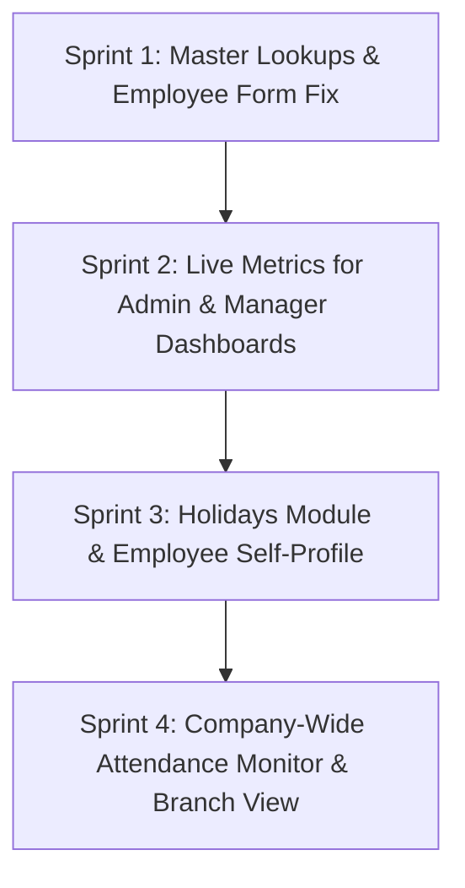

# AlienHR — Next Developments Plan

---

## Roadmap Overview

---

## 🚀 Sprint 1: Master Lookups & Employee Form Fix (Immediate Next Step)

> **Objective:** Fix the employee creation/editing process so admins can dynamically choose Department, Designation, Branch, Employment Type, and Role instead of relying on hardcoded IDs and an empty department list.

### 1. Backend (`HRMS.API`)
* **Create `LookupController.cs` (`/api/Lookup`)**:
  * `GET /api/Lookup/departments` — Returns `id`, `name`, `code` for all active departments.
  * `GET /api/Lookup/designations` — Returns `id`, `name` for designations.
  * `GET /api/Lookup/employment-types` — Returns `id`, `name` (Permanent, Contract, Intern, etc.).
  * `GET /api/Lookup/roles` — Returns assignable user roles (Admin, Manager, Employee).
  * `GET /api/Lookup/branches` — Reuses or maps `BranchRepository.GetAllAsync()`.

### 2. Flutter Mobile (`alionhr mobile`)
* **Create Master Lookup Model & Service**:
  * Create `lib/models/lookup_item.dart` (`id`, `name`).
  * Create `lib/services/lookup_service.dart` with methods to fetch all lookup lists.
* **Update `lib/ui/employee/employee_form_page.dart`**:
  * Remove hardcoded defaults (`companyId: 1`, `branchId: 1`, `designationId: 1`, `roleId: 4`).
  * Replace the static text and empty dropdowns with live `DropdownButtonFormField`:
    * **Department**: Loaded from `/api/Lookup/departments`.
    * **Designation**: Loaded from `/api/Lookup/designations`.
    * **Branch**: Loaded from `/api/Lookup/branches`.
    * **Employment Type**: Loaded from `/api/Lookup/employment-types`.
    * **Role**: Loaded from `/api/Lookup/roles`.

---

## 📊 Sprint 2: Live Metrics for Admin & Manager Dashboards

> **Objective:** Replace all 100% hardcoded sample data on the Admin and Manager dashboards with real metrics from the database.

### 1. Backend (`HRMS.API`)
* **Create `DashboardController.cs` (`/api/Dashboard`)**:
  * `GET /api/Dashboard/admin-summary`:
    * `totalEmployees`: Count of active employees.
    * `presentToday`: Count of check-ins today.
    * `onLeaveToday`: Count of approved leaves covering today.
    * `absentToday`: `totalEmployees - (presentToday + onLeaveToday)`.
    * `pendingLeaves`: Count of leaves in `Pending` status.
    * `lateEmployees`: Count of today's check-ins with `IsLate == true`.
  * `GET /api/Dashboard/manager-summary?branchId={id}`:
    * Team metrics filtered by branch/department.
    * List of employees currently on leave today (`name`, `leaveType`, `duration`).

### 2. Flutter Mobile (`alionhr mobile`)
* **Update `lib/ui/home/admin/admin_dashboard.dart`**:
  * Wire `_loadAdminDashboard()` to `/api/Dashboard/admin-summary`.
  * Replace static numbers (`245`, `218`, `12`, `15`, `14`, `8`) with live counts.
* **Update `lib/ui/home/manager/manager_dashboard.dart`**:
  * Wire `_loadManagerDashboard()` to `/api/Dashboard/manager-summary`.
  * Display real employees on leave today.

---

## 🏖️ Sprint 3: Holidays Module & Employee Self-Profile

> **Objective:** Enable company holiday viewing and give employees a dedicated profile page.

### 1. Holiday Integration
* **Backend**: Already exists at `GET /api/Holiday`.
* **Flutter**:
  * Create `lib/models/holiday.dart` and `lib/services/holiday_service.dart`.
  * Build `lib/ui/holiday/holidays_page.dart` (calendar & list view of public/mercantile holidays).
  * Update `lib/ui/home/employee/employee_dashboard.dart` to replace `'Sample Public Holiday'` with the next real upcoming holiday.

### 2. Employee Self-Profile
* **Flutter**:
  * Create `lib/ui/profile/profile_page.dart`.
  * Connect "My Profile" button on the dashboard to display the employee's personal record, employment details, and assigned branch coordinates.

---

## 🏢 Sprint 4: Company Attendance Monitor & Branch Management

> **Objective:** Give Admins & Managers full visibility into real-time attendance and branch configuration.

### 1. Company-Wide Attendance Monitor (`Admin & Manager`)
* New screen: `lib/ui/attendance/admin_attendance_page.dart`.
* Displays today's full attendance roster:
  * Filter tabs: **All**, **Present**, **Late**, **On Leave**, **Absent**.
  * Shows exact Check-in time, Check-out time, and distance from branch.

### 2. Branch Management (`Admin`)
* New screen: `lib/ui/branch/branch_list_page.dart`.
* Connects to backend `/api/Branch`.
* Displays branches, addresses, GPS coordinates, and allows setting the `GeofenceRadiusMeters` (e.g. 50m, 100m).
